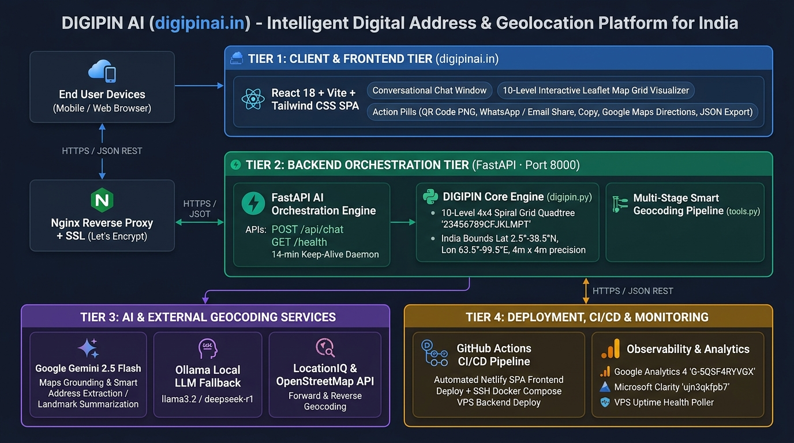

# DIGIPIN AI — High-Level Technical Design Document


* **Project:** DIGIPIN AI (`digipinai`)
* **Production URL:** [https://digipinai.in](https://digipinai.in)
* **Repository:** `github.com/verity-analyst-consulting/digipinai`
* **Owner:** Verity Analyst Consulting Inc.

---

## 1. Executive Overview

**DIGIPIN AI** is an AI-orchestrated geolocation and digital addressing platform built around India's **DIGIPIN (Digital Postal Index Number)** specification. It converts any geographic coordinate or unstructured street address within the Indian subcontinent (`Latitude 2.5°–38.5°N`, `Longitude 63.5°–99.5°E`) into a deterministic 10-character alphanumeric code (`XXX-XXX-XXXX`) with **4m × 4m** doorstep precision—and decodes DIGIPINs back into coordinates, street addresses, and AI-synthesized landmark descriptions.

The platform combines a **React + Vite + Tailwind CSS + Leaflet** single-page web application with a **FastAPI AI Orchestrator** backed by **Google Gemini 2.5 Flash (with Google Maps Grounding)**, **Ollama local LLMs**, and **LocationIQ (OpenStreetMap)** geocoding.

---

## 2. High-Level System Architecture Diagram



---

## 3. Core Functionalities & System Modules

### 3.1 Deterministic 4×4 Quadtree Grid Engine (`digipin.py`)
* **Spatial Bounds:** `LAT_MIN = 2.5`, `LAT_MAX = 38.5`, `LON_MIN = 63.5`, `LON_MAX = 99.5`.
* **16-Character Unambiguous Alphabet:** `23456789CFJKLMPT` arranged in an anticlockwise outward spiral within a 4×4 matrix.
* **Encoding (`encode(lat, lon, precision=10)`):** Recursively subdivides the bounding box into 4×4 cells across 10 iterations, formatting the resulting 10-character code as `XXX-XXX-XXXX` (~4m × 4m resolution).
* **Decoding (`decode(pin)`):** Reverses the 10-level lookup to compute the exact centroid `(center_lat, center_lon)` of the target grid cell.

### 3.2 Conversational AI Orchestrator & Multi-Stage Geocoding (`main.py` & `tools.py`)
The `/api/chat` endpoint classifies incoming natural-language queries into **Coordinate Encoding**, **Address Encoding**, **DIGIPIN Decoding**, or **General Q&A**:

1. **Direct Coordinate Encoding:** Parses decimal and directional coordinates (e.g., `13.0098°N, 77.5511°E`), validates India bounding-box constraints, generates the DIGIPIN, and reverse-geocodes the address via LocationIQ.
2. **Multi-Stage Smart Address Geocoding Pipeline (`smart_geocode`):**
   * **Stage 1 — Gemini Maps Grounding (`forward_geocode_maps`):** Queries `gemini-2.5-flash` with the native `types.GoogleMaps()` tool for high-precision landmark/address resolution.
   * **Stage 2 — LocationIQ Exact Search (`forward_geocode_locationiq`):** Queries OpenStreetMap/LocationIQ API with 6-digit PIN/ZIP validation when present.
   * **Stage 3 — Iterative Token & Comma Stripping:** Progressively strips noisy prefix tokens (house numbers, floor numbers) while preserving locality, street, and postal code.
   * **Stage 4 — LLM Address Cleaning & Landmark Fallback (`ask_llm`):** Prompts Gemini 2.5 Flash (or local Ollama fallback) to normalize unstructured Indian addresses or identify an adjacent permanent landmark, then re-runs geocoding.
   * **Stage 5 — Direct AI Coordinate Retrieval:** Fallback coordinate inference with explicit user confidence disclaimers.
3. **DIGIPIN Decoding with AI Landmark Grounding:** Decodes a 10-character PIN into `(lat, lon)`, fetches the street address from LocationIQ, and prompts the LLM to generate a concise 1–2 sentence landmark summary.

### 3.3 Interactive Frontend & 10-Step Grid Visualizer (`apps/frontend`)
* **Conversational Chat Window (`ChatWindow.tsx`):** Renders markdown responses, embedded interactive Leaflet maps (`MapComponent.tsx`), starter suggestion cards, and one-click action pills:
  * **QR Code Generator:** Client-side `QRCodeCanvas` rendering with one-click `.png` download (`digipin-<CODE>.png`).
  * **Clipboard Copy:** Copies formatted DIGIPIN, address, landmark, and Google Maps URL.
  * **Direct Sharing:** One-click WhatsApp (`wa.me`) and Email (`mailto:`) sharing.
  * **Google Maps Deep-Link & Raw JSON Inspector.**
* **10-Step Interactive Grid Visualizer (`DigipinVisualizer.tsx`):** Uses `react-leaflet` and bundled official India GeoJSON boundaries (`indiaOutline.ts`) to visually step through all 10 recursive 4×4 subdivisions (from `~1,000 km` at Step 1 down to `~4 m` at Step 10) for **ISKCON Temple, Bengaluru (`4PJ-779-9TJT`)**.

---

## 4. Technology Stack

### 4.1 Code & Frameworks
| Tier | Technology | Version / Purpose |
| :--- | :--- | :--- |
| **Frontend UI** | React 18 + TypeScript + Vite | `react ^18.2.0`, `typescript ^5.6.2`, `vite ^5.4.0`, `react-router-dom ^7.10.1` |
| **Styling & Motion** | Tailwind CSS + Framer Motion | `tailwindcss ^3.4.13`, `framer-motion ^12.23.26`, `@headlessui/react` |
| **Mapping & QR** | Leaflet + React-Leaflet + QRCode | `leaflet ^1.9.4`, `react-leaflet ^4.2.1`, `qrcode.react ^4.2.0` |
| **Backend API** | Python 3.11+ & FastAPI | `fastapi==0.115.0`, `uvicorn[standard]==0.30.6`, `pydantic==2.9.2` |
| **AI & LLM SDKs** | Google GenAI SDK + Ollama REST | `google-genai` (`gemini-2.5-flash` + Maps Grounding), Ollama (`llama3.2` / `deepseek-r1:1.5b`) |
| **Geocoding API** | LocationIQ REST API | Forward (`/v1/search.php`) and Reverse (`/v1/reverse.php`) OpenStreetMap geocoding |
| **Reverse Proxy** | Nginx | `nginx:stable-alpine` routing `/`, `/api/chat`, and `/geo/` with Let's Encrypt TLS |

### 4.2 CI/CD & Deployment Pipeline
* **Frontend Deployment (`.github/workflows/frontend_netlify_deploy.yml` & `netlify.toml`):**
  * Triggered on pushes to `main` touching `apps/frontend/**` or `netlify.toml`.
  * Runs on `ubuntu-latest` (Node.js 18): executes `npm ci` and `npm run build` with `VITE_API_BASE` injected from GitHub Secrets.
  * Deploys production static assets (`apps/frontend/dist`) to **Netlify CDN** (`https://digipinai.in`) via `netlify/actions/cli@v4`.
* **Backend Deployment (`.github/workflows/deploy.yml` & `scripts/deploy_backend.sh`):**
  * Triggered on pushes to `main` touching `apps/ai_orchestrator/**`, `apps/geo_service/**`, `infra/**`, or `scripts/**`.
  * Connects via SSH (`webfactory/ssh-agent`) to the production VPS (`api.digipinai.in`) or cloud service, synchronizes `origin/main`, builds/restarts services via `docker-compose.prod.yml`, and runs a 10-attempt HTTPS `/health` verification loop.

### 4.3 Local Execution & Development
Run two terminal sessions—one for the FastAPI AI Orchestrator (Port `8000`) and one for the Vite React Frontend (Port `5173`):

```bash
# Terminal 1: Start Backend AI Orchestrator (Port 8000)
cd digipinai/apps/ai_orchestrator
python3 -m venv venv
source venv/bin/activate
pip install -r requirements.txt
cp .env.example .env   # Configure GEMINI_API_KEY, LOCATIONIQ_API_KEY, OLLAMA_URL
uvicorn main:app --reload --port 8000
# Swagger API Docs: http://localhost:8000/docs

# Terminal 2: Start Frontend Web Application (Port 5173)
cd digipinai/apps/frontend
npm install
export VITE_API_BASE=http://localhost:8000
npm run dev
# Local Web App: http://localhost:5173
```

*(Optional Docker Compose development stack is also available via `docker compose -f infra/compose/docker-compose.dev.yml up --build`.)*

---

## 5. Monitoring, Analytics & Observability

### 5.1 Google Analytics 4 (GA4) Integration
* **Library:** `react-ga4` (`^2.1.0`) initialized in `apps/frontend/src/App.tsx`.
* **GA4 Measurement ID:** `G-5QSF4RYVGX` (configurable via `VITE_GA_MEASUREMENT_ID`).
* **Tracked Events & Pageviews:**
  * Automatic initial `pageview` dispatch on application load.
  * Custom user interaction events in `ChatWindow.tsx`:
    * `Category: "User", Action: "Copy Info", Label: <digipin>`
    * `Category: "User", Action: "Download QR", Label: <digipin>`
    * `Category: "User", Action: "Share", Label: "WhatsApp" | "Email"`

### 5.2 Microsoft Clarity Session & Heatmap Analytics
* **Library:** `react-microsoft-clarity` (`^2.0.0`) initialized in `apps/frontend/src/App.tsx`.
* **Clarity Project ID:** `ujn3qkfpb7` (tracks click heatmaps, scroll depth, and UI session diagnostics).

### 5.3 System Health Polling & Self-Healing Keep-Alive
* **Frontend Live Status Indicator (`App.tsx`):** Polls `GET ${VITE_API_BASE}/health` on startup and every `30 seconds`, driving the header status badge (`System Ready` green vs. `Connecting...` amber/red) and gracefully disabling the chat input box while the backend wakes up.
* **Backend Keep-Alive Daemon (`main.py` → `_keep_alive`):** Background daemon thread pings `SELF_URL` (`/health`) every `14 minutes` to prevent cold-start spin-downs on cloud hosting tiers.
* **Container Healthchecks (`docker-compose.prod.yml`):** Docker-level `wget`/`curl` health probes every `30s` across `ai-orchestrator`, `geo-service`, and `nginx`.

---

## 6. Intellectual Property & Ownership Notice

**PROPRIETARY & CONFIDENTIAL — VERITY ANALYST CONSULTING INC.**

* **Conceived, Architected, and Owned By:** Verity Analyst Consulting Inc. / Pavan Praveen Kulkarni.
* **Initial Inception:** 2025–2026.
* **Corporate Namespace:** `github.com/verity-analyst-consulting/digipinai` (Private Restricted Repository).
* **Scope of Protection:** This technical design document, the DIGIPIN AI orchestration platform, multi-stage AI geocoding fallback pipeline, interactive 10-step grid visualizer, system architecture diagrams, and all forthcoming derivative works, source code modules, and associated documentation are the sole intellectual property of **Verity Analyst Consulting Inc.**
* **Clean-Room Development Assurance:** Conceived and developed entirely independently on personal equipment and outside business hours, without the use of third-party employer resources, proprietary networks, confidential databases, or corporate assets.

*© 2026 Verity Analyst Consulting Inc. All rights reserved.*
